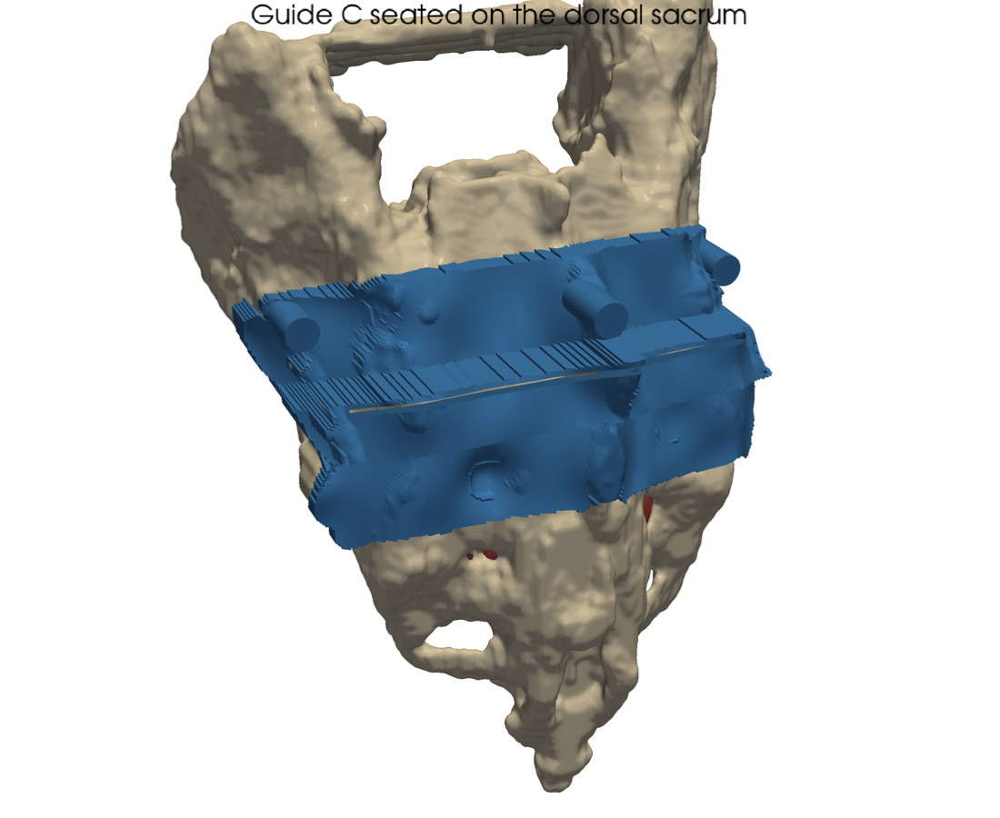
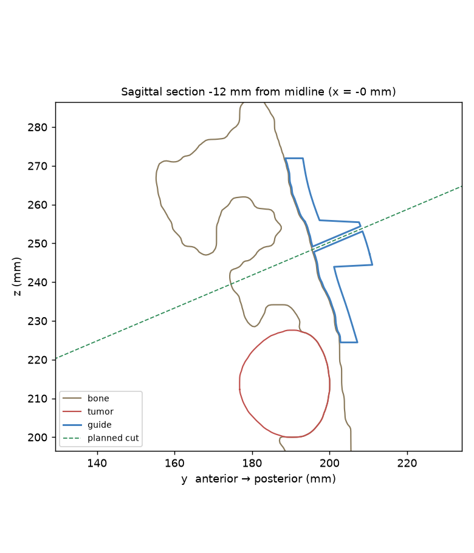

# Patient-Specific Sacral Resection Guide

A scripted pipeline that goes from a pelvic CT scan to a 3D-printable, surface-matched osteotomy guide for
sacral tumor resection. It includes resection planning, a design comparison, a seating-stability simulation, FEA,
and a bench-test kit for physical validation.

> ⚠️ **Research and education project, not for clinical use.** Patient-specific surgical guides are regulated
> medical devices. Nothing here has been clinically validated.

<p align="center">
  
  
</p>

**Pipeline:** CT → sacrum segmentation → osteotomy plan (10 mm margin) → 3 guide variants → seating-stability
simulation → FEA → printable STLs + bench-test kit.

## Key results (computational, see [REPORT.md](REPORT.md))
| | Narrow guide (A) | Wide guide (B) | Wide + K-wires (C) |
|---|---|---|---|
| Bone contact area | 21.7 cm² | 44.8 cm² | 44.8 cm² |
| 95th-pct cut offset (simulated seating) | 0.53 mm | 0.31 mm | 0.31 mm |
| 95th-pct cut tilt | 1.16° | 0.48° | 0.48° |

- **A wider footprint is the biggest accuracy lever:** it cuts offset by 42 % and tilt by 59 %.
- **Slot clearance, not material stiffness, limits blade accuracy.** FEA gives a few µm of slot-wall deflection
  under a 20 N saw load. The 0.13 mm blade clearance allows ~120× more angular play.
- **The weakest seating direction is cranio-caudal slide.** The next design step is to wrap a bony feature that resists it.
- **The cut-measurement method is validated on synthetic cuts:** ≤0.18 mm / ≤0.26° error.

Physical bench tests (cut accuracy, multi-user repeatability, autoclave stability) are specified in
[validation/PROTOCOLS.md](validation/PROTOCOLS.md) but **not yet performed**.

## Data
`outputs/` and `REPORT.md` come from a **real CT**: TCIA *Pelvic-Reference-Data*, patient Pelvic-Ref-003
(CC BY 3.0, [doi:10.7937/TCIA.2019.woskq5oo](https://doi.org/10.7937/TCIA.2019.woskq5oo), 1 × 1 × 3 mm voxels).
The sacrum was segmented with TotalSegmentator and refined to 0.6 mm. **The chordoma is simulated**, because no
public sacral-chordoma CT exists. The raw CT isn't redistributed here; `real_ct.py` regenerates everything from the TCIA download.

`outputs_phantom/` and [REPORT_phantom.md](REPORT_phantom.md) hold an earlier known-truth run on a synthetic phantom,
which verified the pipeline. Segmentation Dice was 0.93 for bone and 0.95 for tumor.

**Citations:** *Pelvic-Reference-Data* [Data set], The Cancer Imaging Archive (2019), doi:10.7937/TCIA.2019.woskq5oo;
Clark K, et al. *J Digit Imaging* 2013 (TCIA); Wasserthal J, et al. *Radiol Artif Intell* 2023 (TotalSegmentator).

## Setup
Python 3.10+. Create and activate a virtual environment:

**macOS / Linux**
```bash
python3 -m venv venv
source venv/bin/activate
```
**Windows (PowerShell)**
```powershell
python -m venv venv
venv\Scripts\Activate.ps1
```

With the venv active, the rest is the same on every OS:
```bash
pip install -r requirements.txt

# Real CT: download the DICOM series from TCIA, then run the commands below.
# Sacrum segmentation takes ~30 s on CPU; the first run downloads ~1.4 GB of model weights.
python real_ct.py --dicom path/to/dicom --tumor-level 0.68
python run_all.py --bone outputs/bone.stl --tumor outputs/tumor.stl   # ~20 min with FEA; add --skip-fea for ~20 s

# Or the synthetic phantom (no download needed):
python run_all.py

# Bench-test kit
python validation/fixture.py               # test_fixture.stl + figures/09_fixture.png
python validation/analyze_cut.py --selftest
python validation/autoclave_coupon.py --make
python make_report.py
```
On a headless Linux machine, the PyVista figure rendering needs an off-screen display. Install `xvfb`, then
run the scripts under `xvfb-run`, for example `xvfb-run python run_all.py`.

## Files
| File | What it does |
|---|---|
| `real_ct.py` | DICOM → TotalSegmentator sacrum → sub-voxel HU surface → simulated presacral chordoma (dorsal cortex intact) |
| `phantom.py` | Synthetic CT: cortical/cancellous bone, canal, 4 foramen pairs, crests, chordoma, noise |
| `segment.py` | Threshold → morphology → islands → marching cubes; Dice vs ground truth |
| `plan.py` | Cephalad osteotomy plane, `margin` mm above the tumor, normal to the local sacral axis (midline-column fit) |
| `guide.py` | Surface-matched guide: height-map underside, foramen bridging, tumor keep-out, housing, exact slot, end bridges, safe K-wire siting |
| `stability.py` | Linearized rigid-body seating model → cut offset/tilt distribution, weakest motion mode |
| `fea.py` | scikit-fem hex FEA of slot-wall deflection under saw load; material, support and housing-height studies; mesh convergence; slot play |
| `render.py`, `make_report.py` | Figures and report |
| `validation/` | Bench-test protocols, printable fixture/coupon, analysis scripts, data sheets |
| `outputs/guide_*.stl` | Printable guides A, B, C |

## Design rules encoded in `guide.py`
1. **One insertion direction, no undercuts.** The underside is the bone surface seen from the posterior approach
   direction, so the guide seats along one path and can't be "almost on".
2. **0.3 mm clearance** for print tolerance and residual periosteum.
3. **Foramina are bridged, not filled.** The guide stays 1 mm off hole edges and doesn't rely on soft-tissue-filled holes for location.
4. **No contact within 3 mm of tumor**, to avoid contaminating the guide or seeding tumor cells.
5. **Slot = 1.27 mm blade + 0.13 mm clearance**, cut on the exact planned plane. A raised housing gives guidance depth,
   and closed end bridges keep the guide one piece.
6. **K-wires run parallel to the insertion direction**, so the guide lifts off over the wires after the cut.
   Wires go only where the bone is ≥ 18 mm thick along the wire path (no anterior breach toward the presacral vessels,
   no canal or foramen), ≥ 10 mm from the tumor, and preferentially in the preserved bone.

## Lessons learned (bugs caught during development)
- **FEA load selection was mesh-dependent.** A distance-band node selection picked interior nodes at some mesh sizes, so
  deflection jumped 3 → 9 µm. Loading true boundary-face nodes fixed it.
- **The first test fixture would have corrupted its own measurement.** 96 mm PLA support columns deflect ~1.6 mm under a 20 N press.
  It was redesigned with a solid anterior cradle and backplate.
- **Naive ICP biased cut measurement by up to 1.7 mm.** The new cut face was being matched to the intact model.
  Trimmed point-to-plane ICP brought the error to <0.2 mm.
- **The sacral axis was biased by the alae.** Whole-slice centroids tilted the cut plane by ~14° on real anatomy,
  and 3 mm slices made it noisy. A midline-column fit over a ±25 mm window fixed both.

## License
Code: MIT. Derived imaging meshes: CC BY 3.0 (TCIA). See [LICENSE](LICENSE).
