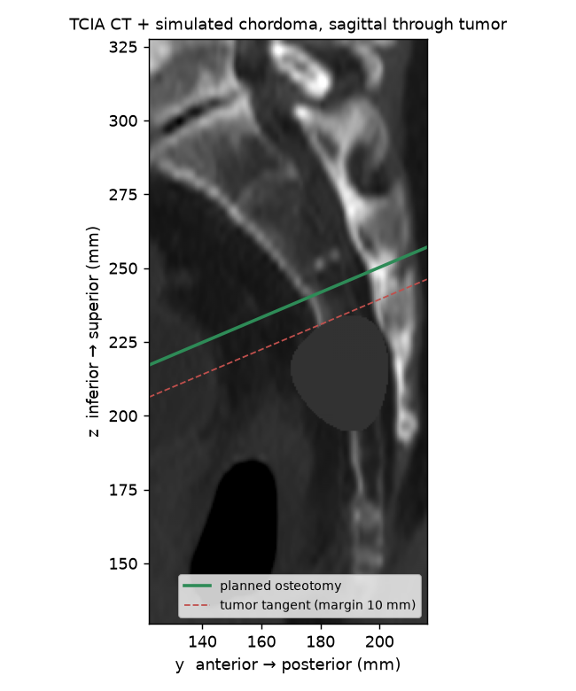
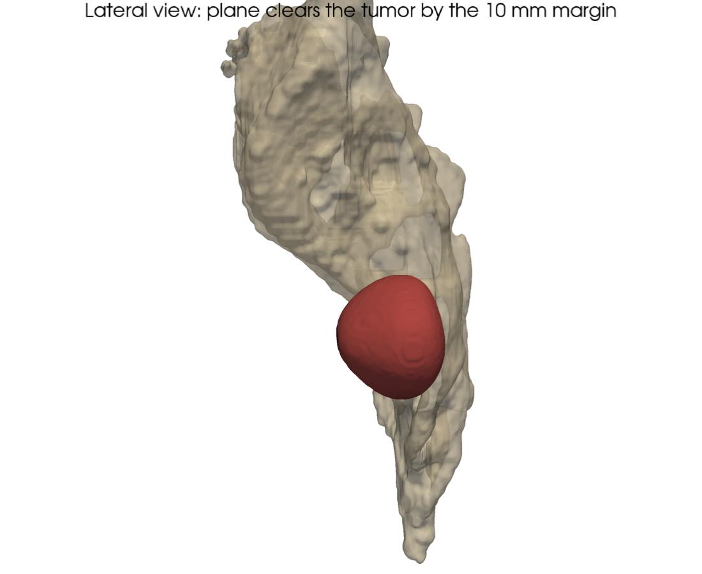
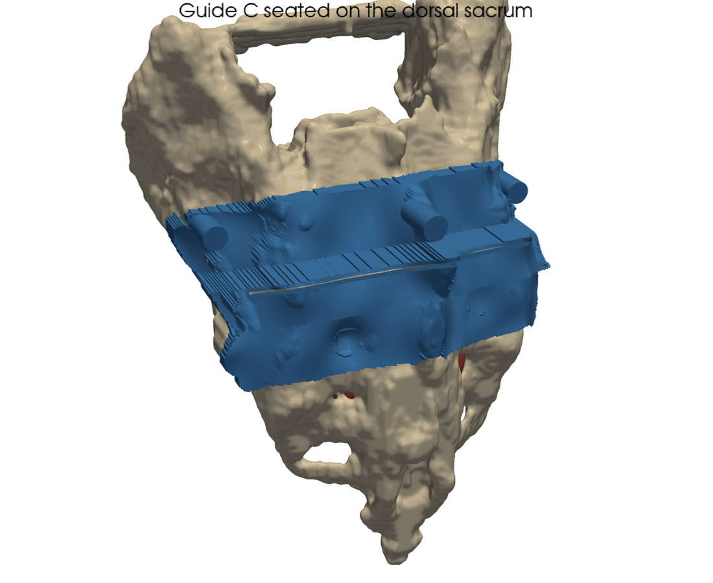
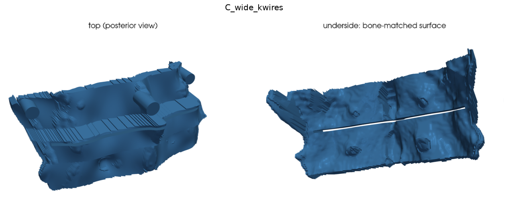
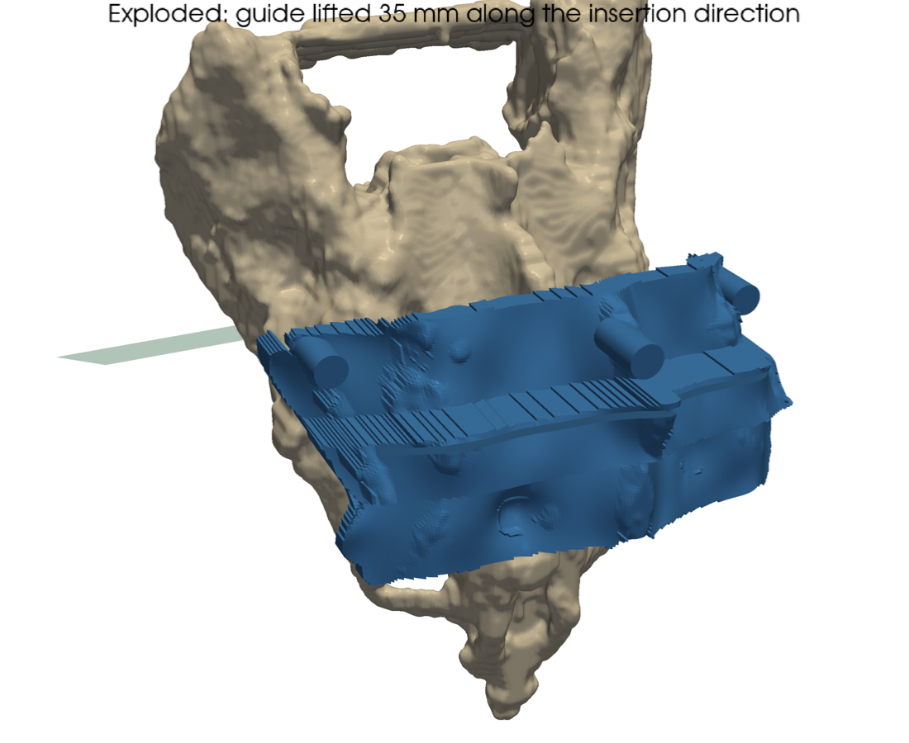
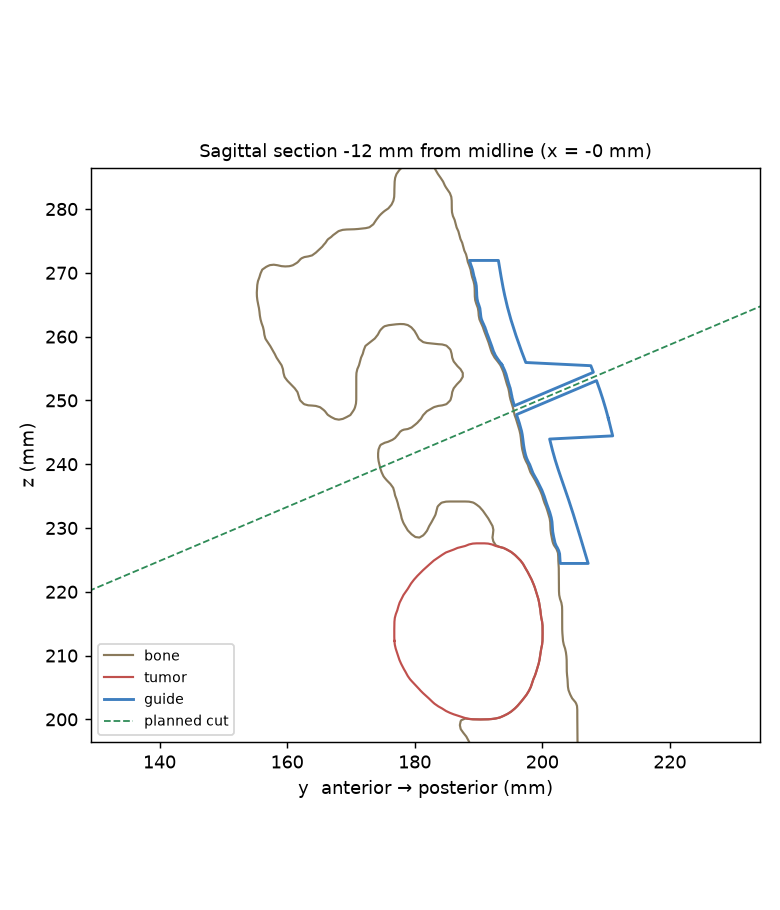
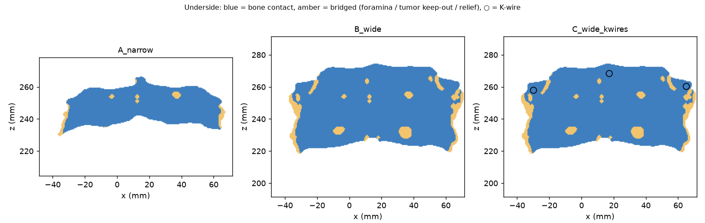
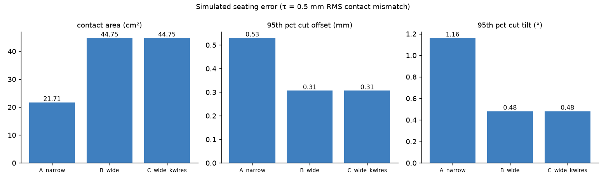
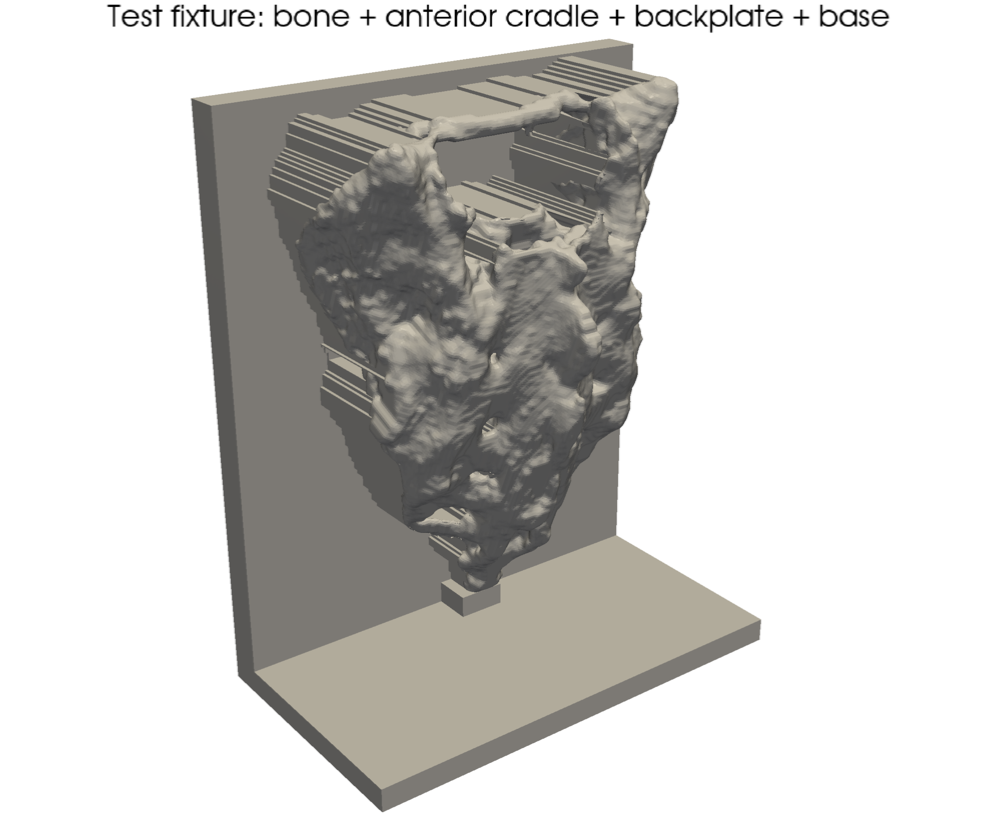

# Sacral resection guide: results (TCIA CT, simulated tumor)

> All numbers below are **computational**: they come from simulation on the CT below. The physical tests in `validation/PROTOCOLS.md` are what turn them into measured results.

## Key findings

1. **A wider footprint is the biggest accuracy lever.** Going from A to B doubles contact area (21.7 → 44.8 cm²). It cuts the 95th-percentile cut offset from 0.53 to 0.31 mm (−42 %) and the tilt from 1.16° to 0.48° (−59 %).
2. **The weakest direction is slide z (cranio-caudal)** for every variant: the dorsal sacrum is smoothest along its long axis. Next design step: make the footprint wrap a feature that resists that slide, such as the median-crest tubercles, the S1 superior articular process, or the lateral sacral border.
3. **Elastic bending is not the error source; slot clearance is.** Under 20 N the PA12 slot wall deflects ~1.8 µm (0.004°). The 0.13 mm blade clearance allows 0.53° of rigid wobble, about 121× more. So material should be chosen for sterilization stability and biocompatibility, not stiffness, and a taller housing or tighter slot is the accuracy lever (14 mm housing → 0.41°). The cost is a taller profile in the wound.
4. **K-wires matter only if seating contact is lost.** With pins carrying the load alone, deflection rises to 25 µm (×14). That is still small. The real job of the K-wires is to stop the guide sliding during sawing (finding 2's weakest mode), which only the bench test can quantify.
5. **The measurement method is good enough for the job.** The cut-analysis pipeline recovers known errors to ≤0.18 mm / ≤0.26°, more than 10× finer than the 2 mm / 3° pass criteria.

## 1. Data and segmentation

* **CT:** TCIA Pelvic-Reference-Data, Pelvic-Ref-003 (CC BY 3.0, doi:10.7937/TCIA.2019.woskq5oo). Matrix [512, 512, 145], voxel spacing 1.00, 1.00, 3.00 mm.
* **Sacrum:** TotalSegmentator (`--roi_subset sacrum`), then sub-voxel refinement: cubic resampling of the CT to 0.6 mm and an HU iso-surface inside the label. Label volume 247.8 mL.
* **Tumor: SIMULATED.** No public sacral-chordoma CT exists. A lobulated 27.7 mL anterior mass was placed at 68 % of the sacral length from S1, which is roughly S3–S4, the typical chordoma site. It replaces 17.8 mL of bone.
* **Limitation:** the 3.0 mm slice spacing smooths the surface along z. A clinical guide would use ≤1 mm slices.

## 2. Resection plan

* Planned bone margin **10 mm**, set from the 8–10 mm used in published PSI sacrectomy planning, where the margin also had to absorb guide error.
* Cut plane normal [0.0, -0.39, 0.921], crossing the sacral midline at z ≈ 245.3 mm (cut at 63 % of sacral length from S1; check the level against the foramina in the figures). 
* 63 % of the bone surface is preserved. The minimum tumor-to-plane distance is 10.0 mm.

## 3. Guide variants

| Variant | Contact area (cm²) | Volume (cm³) | Slot length (mm) | K-wires | Watertight |
|---|---|---|---|---|---|
| A_narrow | 21.7 | 18.7 | 88.5 | 0 | True |
| B_wide | 44.8 | 29.9 | 88.5 | 0 | True |
| C_wide_kwires | 44.8 | 30.9 | 88.5 | 3 | True |

## 4. Seating stability (simulation)

Linearized rigid-body model with τ = 0.5 mm RMS random contact mismatch per 5 mm patch (the assumed residual soft tissue and seating noise).

| Variant | Patches | Offset mean / 95th (mm) | Tilt mean / 95th (°) | Margin used, 95th | Weakest mode |
|---|---|---|---|---|---|
| A_narrow | 87 | 0.21 / 0.53 | 0.59 / 1.16 | 5 % | rot x (flex/ext) |
| B_wide | 181 | 0.13 / 0.31 | 0.24 / 0.48 | 3 % | slide z (cranio-caudal) |
| C_wide_kwires | 181 | 0.13 / 0.31 | 0.24 / 0.48 | 3 % | slide z (cranio-caudal) |

Errors scale linearly with τ, so at τ = 1 mm double them. K-wires don't change *seating* accuracy in this model. Their job is holding the pose during sawing, which the FEA below covers.

## 5. FEA: slot wall under saw load

Load: 20.0 N on the cephalad slot wall, along the plane normal. Hex voxel mesh, 0.8 mm pitch, PA12 (E = 1.7 GPa).

| Variant | Support | Elements | Slot-wall top edge (µm) | Wall max (µm) | Blade angle from deflection (°) |
|---|---|---|---|---|---|
| A_narrow | bonded | 36608 | 1.8 | 3.4 | 0.005 |
| B_wide | bonded | 58321 | 1.8 | 3.7 | 0.004 |
| C_wide_kwires | bonded | 60149 | 1.8 | 3.7 | 0.004 |
| C_wide_kwires | pins | 60149 | 25.5 | 45.3 | 0.036 |
| C_wide_kwires | both | 60149 | 1.8 | 3.7 | 0.004 |

**Material (B, bonded, scaled by 1/E):**

| Material | Deflection (µm) | Angle (°) |
|---|---|---|
| PA12 (SLS) | 3.69 | 0.0044 |
| Biocompatible SLA resin | 2.41 | 0.0029 |
| Ti-6Al-4V (DMLS) | 0.06 | 0.0001 |

**Housing height trade-off (B, PA12):** taller housing = more guidance but a longer cantilever.

| Housing (mm) | FEA deflection (µm) | FEA angle (°) | Slot-play angle (°) |
|---|---|---|---|
| 6 | 0.8 | 0.001 | 0.74 |
| 10 | 3.7 | 0.004 | 0.53 |
| 14 | 6.6 | 0.007 | 0.41 |

Slot-play angle = atan(0.13 mm clearance / guided depth): the rigid wobble the blade has in the slot.

**Mesh convergence (B, bonded):** 1.2 mm → 3.28 µm (17262 el), 1.0 mm → 4.88 µm (29808 el), 0.8 mm → 3.69 µm (58321 el), 0.6 mm → 3.18 µm (138232 el). The roughly ±25 % scatter comes from the stair-stepped voxel slot walls. It doesn't change the conclusion, because elastic deflection is orders of magnitude below slot play.

## 6. Measurement-method check

`analyze_cut.py` recovered known synthetic cut errors to within **0.176 mm** and **0.264°**, with 0.08 mm scanner noise and a 4°/5 mm initial misregistration.

| True offset | True angle | Measured offset | Measured angle | Flatness RMS |
|---|---|---|---|---|
| 0.0 | 0.0 | 0.035 | 0.196 | 0.327 |
| -1.5 | 0.0 | -1.409 | 0.206 | 0.389 |
| 1.0 | 3.0 | 1.176 | 2.844 | 0.283 |
| -0.8 | 5.0 | -0.693 | 4.736 | 0.379 |

Test fixture: the planned plane sits 111.08 mm above the table, and the expected blade lower face is at 110.38 mm.

