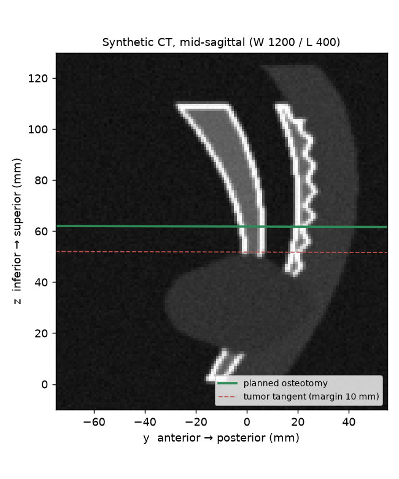
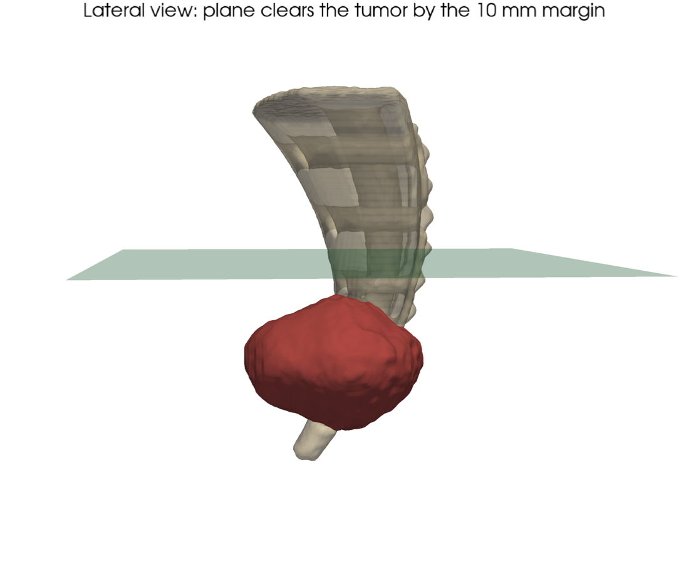
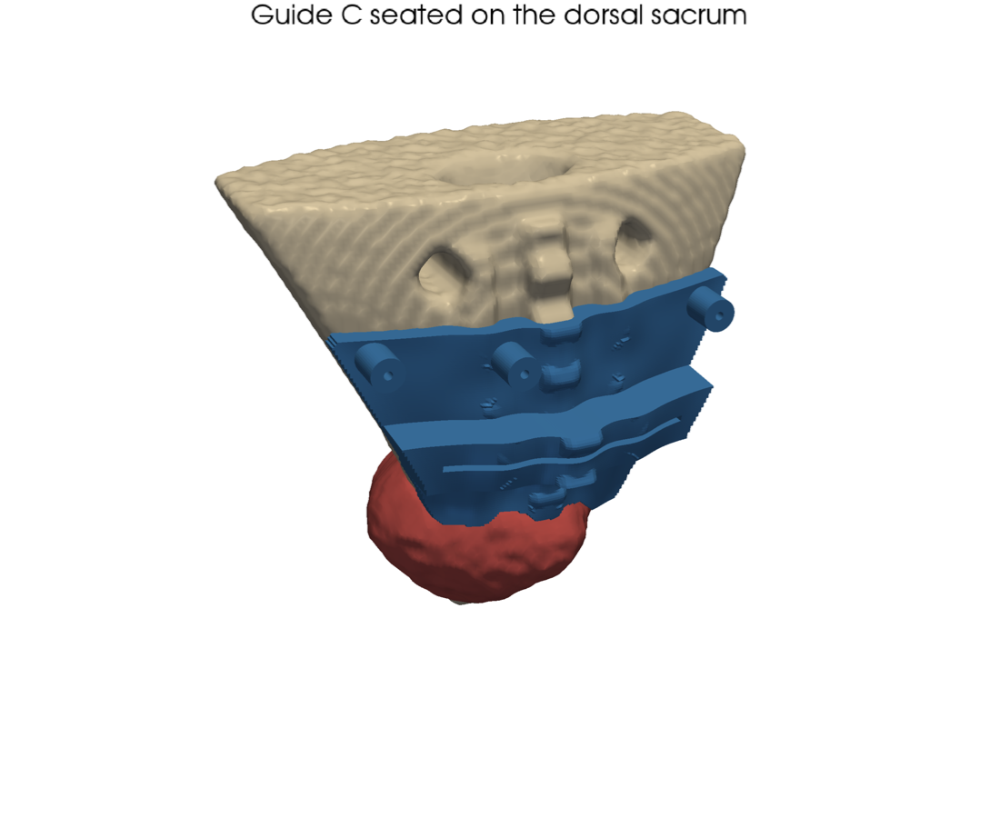
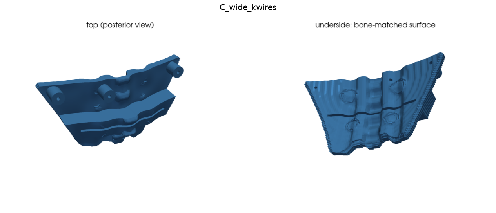
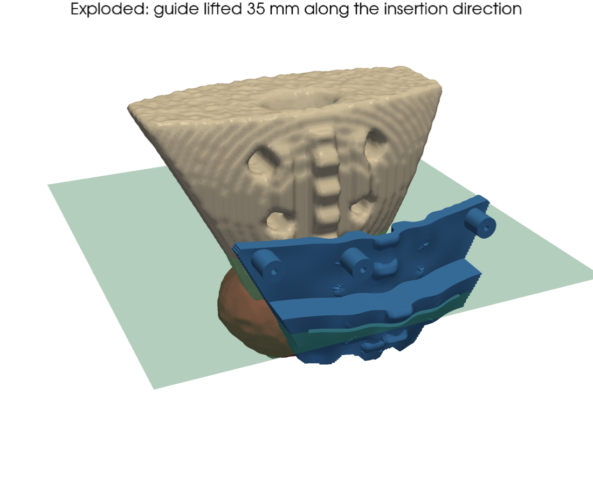
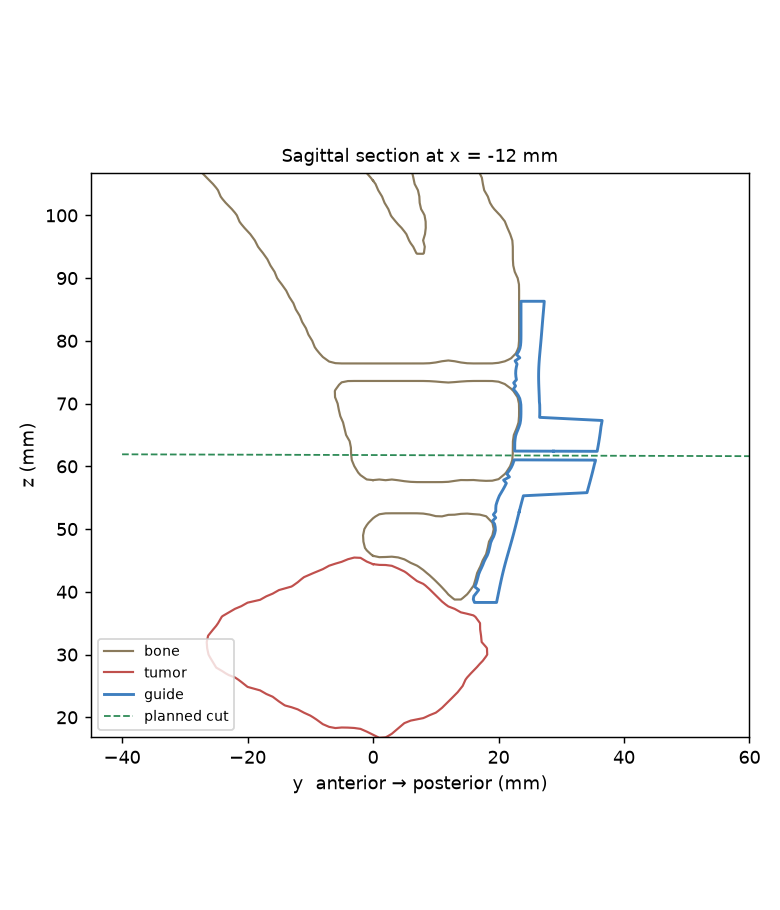
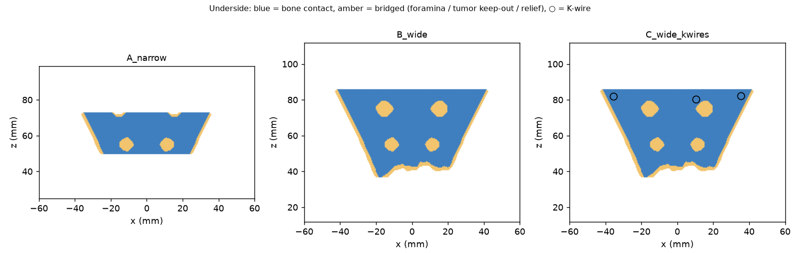
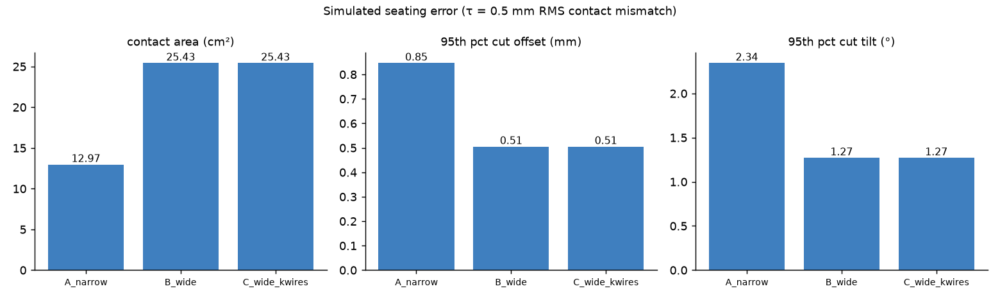
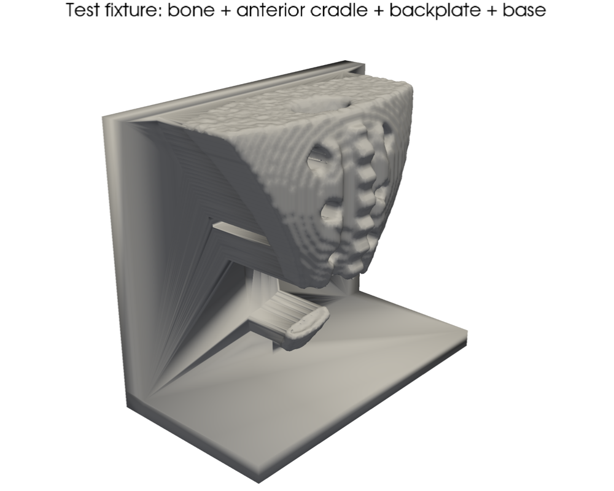

# Sacral resection guide: results (synthetic phantom run)

> All numbers below are **computational**: they come from a synthetic CT phantom and simulation. The physical tests in `validation/PROTOCOLS.md` are what turn them into measured results.

## Key findings

1. **A wider footprint is the biggest accuracy lever.** Going from A to B doubles contact area (13.0 → 25.4 cm²). It cuts the 95th-percentile cut offset from 0.85 to 0.51 mm (−40 %) and the tilt from 2.34° to 1.27° (−46 %).
2. **The weakest direction is slide z (cranio-caudal)** for every variant: the dorsal sacrum is smoothest along its long axis. Next design step: make the footprint wrap a feature that resists that slide, such as the median-crest tubercles, the S1 superior articular process, or the lateral sacral border.
3. **Elastic bending is not the error source; slot clearance is.** Under 20 N the PA12 slot wall deflects ~2.3 µm (0.008°). The 0.13 mm blade clearance allows 0.53° of rigid wobble, about 64× more. So material should be chosen for sterilization stability and biocompatibility, not stiffness, and a taller housing or tighter slot is the accuracy lever (14 mm housing → 0.41°). The cost is a taller profile in the wound.
4. **K-wires matter only if seating contact is lost.** With pins carrying the load alone, deflection rises to 22 µm (×9). That is still small. The real job of the K-wires is to stop the guide sliding during sawing (finding 2's weakest mode), which only the bench test can quantify.
5. **The measurement method is good enough for the job.** The cut-analysis pipeline recovers known errors to ≤0.15 mm / ≤0.31°, more than 10× finer than the 2 mm / 3° pass criteria.

## 1. Segmentation

Threshold/morphology segmentation against phantom ground truth: **Dice bone 0.931, tumor 0.952**. Tumor volume 49.8 mL.

## 2. Resection plan

* Planned bone margin **10 mm**, set from the 8–10 mm used in published PSI sacrectomy planning, where the margin also had to absorb guide error.
* Cut plane normal [0.0, 0.003, 1.0], crossing the sacral midline at z ≈ 61.5 mm (phantom foramina: S2 at z = 75, S3 at z = 55). That is a sacral amputation between the S2 and S3 levels, preserving the S1–S2 roots.
* 79 % of the bone surface is preserved. The minimum tumor-to-plane distance is 10.0 mm.

## 3. Guide variants

| Variant | Contact area (cm²) | Volume (cm³) | Slot length (mm) | K-wires | Watertight |
|---|---|---|---|---|---|
| A_narrow | 13.0 | 12.4 | 52.5 | 0 | True |
| B_wide | 25.4 | 18.5 | 52.5 | 0 | True |
| C_wide_kwires | 25.4 | 19.3 | 52.5 | 3 | True |

## 4. Seating stability (simulation)

Linearized rigid-body model with τ = 0.5 mm RMS random contact mismatch per 5 mm patch (the assumed residual soft tissue and seating noise).

| Variant | Patches | Offset mean / 95th (mm) | Tilt mean / 95th (°) | Margin used, 95th | Weakest mode |
|---|---|---|---|---|---|
| A_narrow | 53 | 0.34 / 0.85 | 1.14 / 2.34 | 8 % | slide z (cranio-caudal) |
| B_wide | 92 | 0.21 / 0.51 | 0.60 / 1.27 | 5 % | slide z (cranio-caudal) |
| C_wide_kwires | 92 | 0.21 / 0.51 | 0.60 / 1.27 | 5 % | slide z (cranio-caudal) |

Errors scale linearly with τ, so at τ = 1 mm double them. K-wires don't change *seating* accuracy in this model. Their job is holding the pose during sawing, which the FEA below covers.

## 5. FEA: slot wall under saw load

Load: 20.0 N on the cephalad slot wall, along the plane normal. Hex voxel mesh, 0.8 mm pitch, PA12 (E = 1.7 GPa).

| Variant | Support | Elements | Slot-wall top edge (µm) | Wall max (µm) | Blade angle from deflection (°) |
|---|---|---|---|---|---|
| A_narrow | bonded | 23764 | 3.2 | 4.5 | 0.012 |
| B_wide | bonded | 35857 | 2.3 | 3.1 | 0.008 |
| C_wide_kwires | bonded | 37435 | 2.3 | 3.1 | 0.008 |
| C_wide_kwires | pins | 37435 | 21.9 | 25.8 | 0.071 |
| C_wide_kwires | both | 37435 | 2.3 | 3.1 | 0.008 |

**Material (B, bonded, scaled by 1/E):**

| Material | Deflection (µm) | Angle (°) |
|---|---|---|
| PA12 (SLS) | 3.06 | 0.0083 |
| Biocompatible SLA resin | 2.00 | 0.0054 |
| Ti-6Al-4V (DMLS) | 0.05 | 0.0001 |

**Housing height trade-off (B, PA12):** taller housing = more guidance but a longer cantilever.

| Housing (mm) | FEA deflection (µm) | FEA angle (°) | Slot-play angle (°) |
|---|---|---|---|
| 6 | 1.1 | 0.004 | 0.74 |
| 10 | 3.1 | 0.008 | 0.53 |
| 14 | 6.6 | 0.015 | 0.41 |

Slot-play angle = atan(0.13 mm clearance / guided depth): the rigid wobble the blade has in the slot.

**Mesh convergence (B, bonded):** 1.2 mm → 3.47 µm (10747 el), 1.0 mm → 4.21 µm (17850 el), 0.8 mm → 3.06 µm (35857 el), 0.6 mm → 3.52 µm (83748 el). The roughly ±25 % scatter comes from the stair-stepped voxel slot walls. It doesn't change the conclusion, because elastic deflection is orders of magnitude below slot play.

## 6. Measurement-method check

`analyze_cut.py` recovered known synthetic cut errors to within **0.154 mm** and **0.312°**, with 0.08 mm scanner noise and a 4°/5 mm initial misregistration.

| True offset | True angle | Measured offset | Measured angle | Flatness RMS |
|---|---|---|---|---|
| 0.0 | 0.0 | 0.006 | 0.023 | 0.089 |
| -1.5 | 0.0 | -1.641 | 0.312 | 0.18 |
| 1.0 | 3.0 | 0.975 | 3.1 | 0.109 |
| -0.8 | 5.0 | -0.954 | 4.743 | 0.133 |

Test fixture: the planned plane sits 74.30 mm above the table, and the expected blade lower face is at 73.60 mm.

